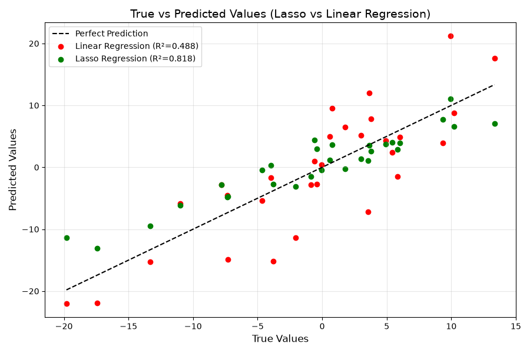

# Linear Models

Exercises on linear models with `scikit-learn`: plain, Ridge and Lasso
regression, model evaluation and explanation with SHAP, logistic regression
and SVM classifiers. All the data is synthetic (fixed seed), so results are
reproducible.

## Quick start

```bash
pip install numpy scikit-learn matplotlib shap
cd machine_learning/linear_models
./0-main.py   # every N-main.py runs the matching task
```

Each task is a pair: `N-name.py` holds the solution and `N-main.py` is a
script that imports it (with `__import__`, because the file names start with
a digit), then prints metrics or saves a plot (`N_main.png`) in the current
directory. Tasks 4 and 5 have two mains (`_1`, `_2`).

## Regression (tasks 0–4)

| Task | File | What it does |
| --- | --- | --- |
| 0 | `0-linear_regression.py` | `Linear_Regression()` returns an unfitted ordinary least squares model. |
| 1 | `1-regression_evaluation_metrics.py` | `evaluation_metrics_for_regression(y_true, y_pred)` returns `(mse, rmse, mae, r2)`. |
| 2 | `2-ridge_regression.py` | `ridge_regression(random_state)` returns a `Ridge` model (L2 penalty). Shrinks coefficients, stays stable with correlated features. |
| 3 | `3-Lasso_regression.py` | `lasso_regression(random_state)` returns a `Lasso` model (L1 penalty). Sets useless coefficients to exactly 0, so it selects features. |
| 4 | `4-shap.py` | `get_shap_explainer_and_values(model, X_train, X_test)` returns the SHAP explainer and the SHAP values of `X_test`; `X_train` is the background data. |

Results from the mains:

- **Task 1**: linear regression on the test set gives MSE 24.55, RMSE 4.95,
  MAE 3.68 and R² 0.827.
- **Task 2**: with two almost identical features (`X2 ≈ X1`), plain linear
  regression splits their weight unstably (coefficients -5.08 and 9.10), while
  Ridge gives a slightly better R² (0.831 vs 0.827).
- **Task 3**: with 50 features of which only 5 matter, Lasso reaches R² 0.819
  using 6 features, while linear regression overfits (R² 0.489, all 50 used).
- **Task 4**: `4-main_1.py` (Linear vs Ridge) and `4-main_2.py` (Linear vs
  Lasso) plot SHAP bar and beeswarm charts to compare feature importance.



## Classification (tasks 5–6)

| Task | File | What it does |
| --- | --- | --- |
| 5 | `5-logisitc_regression.py` | `Logistic_Regression_Model(random_state)` returns an unfitted `LogisticRegression` classifier. |
| 6 | `6-svm.py` | `get_SVM_model(name, random_state)` returns an `SVC` with kernel `'linear'`, `'poly'` or `'rbf'`, and `None` for any other name. |

Results from the mains:

- **Task 5**: on two informative features logistic regression reaches 0.88
  accuracy. `5-main_1.py` plots the decision boundary and `5-main_2.py` the
  predicted probability contour.
- **Task 6**: on three concentric classes (not linearly separable) the linear
  models fail (accuracy 0.27 for logistic regression, 0.37 for linear SVM,
  0.45 for poly), while the RBF kernel separates them almost perfectly
  (about 0.95). `6-main.py` saves the four decision boundaries to
  `6_main.png`.

## Notes

- The file name `5-logisitc_regression.py` keeps the spelling required by the
  project; the mains import it under that name.
- Solution functions only build the model; training and prediction happen in
  the mains.
- Plot images are saved in the directory you run the mains from; `img/` holds
  saved examples.
