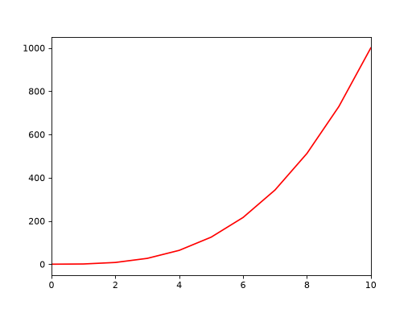
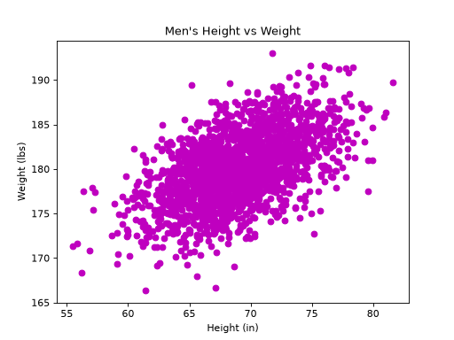
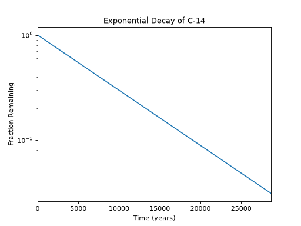
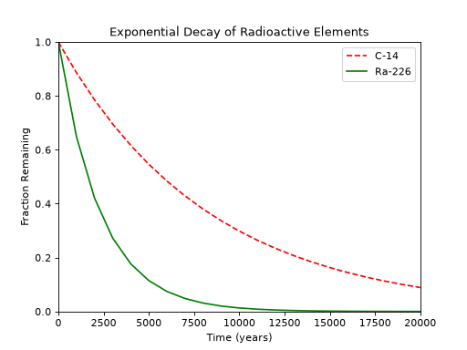
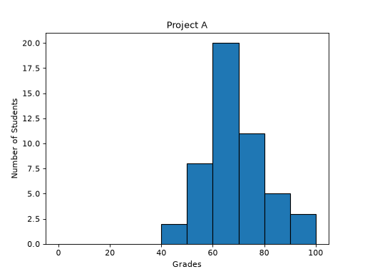
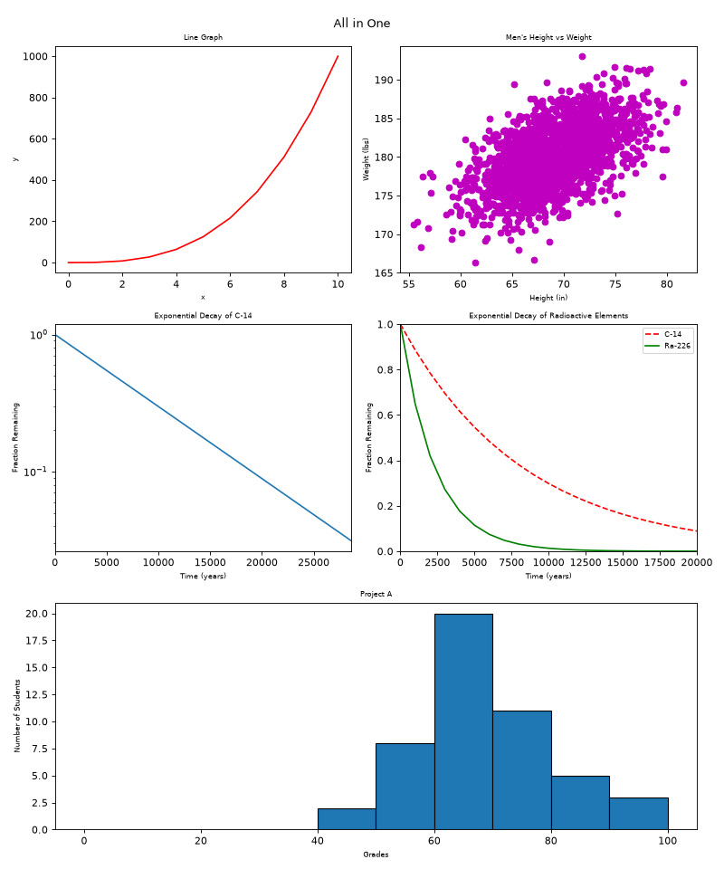
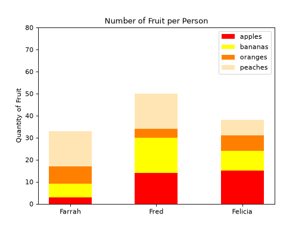

# Plotting

A small collection of **Matplotlib** exercises that turns raw numbers into
charts. Each task is one Python function that builds a single plot, going from
a plain line graph up to a multi-plot dashboard and a stacked bar chart.

If you have never used Matplotlib, this folder is a gentle tour of the
most common chart types: **line, scatter, log-scale, multi-line, histogram,
subplots and stacked bars**.

---

## Table of contents

1. [Quick start](#quick-start)
2. [How the repo is organised](#how-the-repo-is-organised)
3. [How every plot is built](#how-every-plot-is-built)
4. [The tasks](#the-tasks)
5. [Concepts cheat-sheet](#concepts-cheat-sheet)
6. [Requirements and style](#requirements-and-style)

---

## Quick start

```bash
# 1. Install the dependencies
pip install numpy matplotlib

# 2. Run any task through its matching "main" file
cd math/plotting
./0-main.py        # opens a window with the line graph
./6-main.py        # opens a window with the stacked bar chart
```

Or use a function straight from Python:

```python
bars = __import__('6-bars').bars
bars()
```

> The `__import__` form is needed because the file names start with a digit
> (`6-bars.py`), which makes a regular `import 6-bars` invalid in Python.

---

## How the repo is organised

Every task is made of **two files**: the one with the plotting function, and a
tiny "main" file that only calls it.

```
plotting/
├── 0-line.py            ┐
├── 1-scatter.py         │
├── 2-change_scale.py    │  Plotting functions
├── 3-two.py             │  (the actual work lives here)
├── 4-frequency.py       │
├── 5-all_in_one.py      │
├── 6-bars.py            ┘
│
├── 0-main.py            ┐
├── 1-main.py            │
├── ...                  │  Runners: import the function and call it
├── 6-main.py            ┘
│
├── images/              Preview PNGs shown in this README
└── README.md            You are here
```

| Plotting file       | Function         | Runner      | Chart type            |
| ------------------- | ---------------- | ----------- | --------------------- |
| `0-line.py`         | `line()`         | `0-main.py` | Line graph            |
| `1-scatter.py`      | `scatter()`      | `1-main.py` | Scatter plot          |
| `2-change_scale.py` | `change_scale()` | `2-main.py` | Line on a log y-axis  |
| `3-two.py`          | `two()`          | `3-main.py` | Two lines + legend    |
| `4-frequency.py`    | `frequency()`    | `4-main.py` | Histogram             |
| `5-all_in_one.py`   | `all_in_one()`   | `5-main.py` | 5 plots in one figure |
| `6-bars.py`         | `bars()`         | `6-main.py` | Stacked bar chart     |

---

## How every plot is built

All seven functions follow the same recipe:

```
 ┌───────────────┐    ┌───────────────┐    ┌───────────────┐    ┌───────────┐
 │ 1. Make data  │ -> │ 2. New figure │ -> │ 3. Draw + dec-│ -> │ 4. Show   │
 │   (NumPy)     │    │ plt.figure()  │    │   orate       │    │ plt.show()│
 └───────────────┘    └───────────────┘    └───────────────┘    └───────────┘
   arange, exp,         size 6.4 x 4.8       plot / scatter /     opens the
   random, ...                               hist / bar,          window
                                             labels, title,
                                             limits, legend
```

And the run flow when you execute a main file:

```
 ./6-main.py ──► __import__('6-bars') ──► bars() ──► Matplotlib window
   (runner)         (plotting file)      (function)      (the chart)
```

---

## The tasks

### 0. Line graph — `0-line.py`

Plots `y = x³` for `x = 0 … 10` as a solid red line. The x-axis is limited to
`0 – 10`.



### 1. Scatter plot — `1-scatter.py`

Generates 2000 correlated random points (a bell-shaped cloud around a mean
height of 69 in and a weight of 180 lbs) and draws them as magenta dots.
A fixed random seed makes the picture identical on every run.



### 2. Change of scale — `2-change_scale.py`

Radioactive **Carbon-14** decays by half every 5730 years. On a normal axis
that is a curve, but with a **logarithmic y-axis** an exponential decay becomes
a perfectly **straight line**.



### 3. Two is better than one — `3-two.py`

Compares **Carbon-14** (half-life 5730 y, red dashed) with **Radium-226**
(half-life 1600 y, green solid) on the same axes. A legend tells them apart,
and the shorter half-life makes Ra-226 vanish much faster.



### 4. Frequency — `4-frequency.py`

Draws a **histogram** of 50 random student grades, counting how many fall in
each 10-point bin (`0-10`, `10-20`, …, `90-100`).



### 5. All in one — `5-all_in_one.py`

Rebuilds tasks 0–4 as one figure with `plt.subplot` on a 3 × 2 grid. The
histogram uses `plt.subplot2grid(..., colspan=2)` to stretch across the whole
bottom row.

```
 ┌───────────────────┬───────────────────┐
 │  1. Line graph    │  2. Scatter plot  │
 ├───────────────────┼───────────────────┤
 │  3. C-14 decay    │  4. C-14 vs       │
 │     (log scale)   │     Ra-226        │
 ├───────────────────┴───────────────────┤
 │  5. Histogram (spans both columns)    │
 └───────────────────────────────────────┘
```



### 6. Stacked bars — `6-bars.py`

Shows how many apples, bananas, oranges and peaches **Farrah, Fred and
Felicia** own. Each fruit is drawn on top of the previous one using the
`bottom=` argument, so the total height of a bar is the person's total fruit.

```
 bottom=0          bottom=apples        bottom=apples+bananas   ...
 ┌──────┐          ┌──────┐             ┌──────┐
 │apples│    ->    │bananas│     ->     │oranges│    -> peaches on top
 └──────┘          ├──────┤             ├──────┤
                   │apples│             │bananas│
                   └──────┘             │apples│
                                        └──────┘
```



---

## Concepts cheat-sheet

| Call                              | What it does                                      |
| --------------------------------- | ------------------------------------------------- |
| `plt.figure(figsize=(w, h))`      | Creates the canvas (in inches)                    |
| `plt.plot(x, y)`                  | Draws a line (`'r--'` = red dashed, `'g-'` = green solid) |
| `plt.scatter(x, y)`               | Draws one dot per `(x, y)` pair                   |
| `plt.hist(data, bins=...)`        | Counts values per bin and draws bars              |
| `plt.bar(names, values, bottom=)` | Draws bars; `bottom` lets them stack              |
| `plt.xlabel / ylabel / title`     | Adds text labels                                  |
| `plt.xlim / ylim / yticks`        | Controls the visible range and tick marks         |
| `plt.yscale('log')`               | Switches the y-axis to a logarithmic scale        |
| `plt.legend()`                    | Shows the label of each drawn series              |
| `plt.subplot(rows, cols, i)`      | Picks the i-th cell of a grid of plots            |
| `plt.show()`                      | Displays the figure                               |

Handy maths used along the way:

- **Cubes:** `np.arange(0, 11) ** 3`
- **Exponential decay:** `y = exp((ln(0.5) / half_life) * t)` — the fraction of a
  substance left after time `t`.
- **Random data:** `np.random.seed(5)` fixes the "random" numbers so results
  are reproducible.

---

## Requirements and style

- Python 3 with `numpy` and `matplotlib` only
- Files start with `#!/usr/bin/env python3` and are executable
- Code follows `pycodestyle` (max 79 characters per line)
- Every module and function has a docstring
- Only `plt.show()` is used to display a plot; nothing is saved to disk by the
  task functions (the PNGs in `images/` were generated separately for this
  README)
